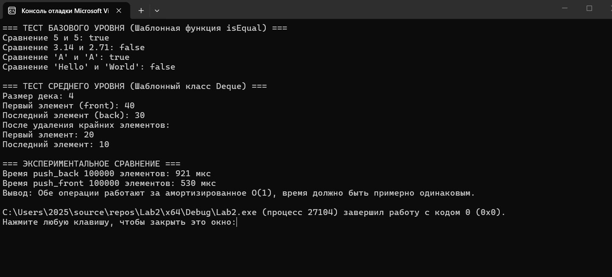

# Лабораторная работа № 2

## «Анализ сложности алгоритмов и шаблоны»

**Выполнил:**__Халмышев Мансур Асланбекович__
**Группа:** __ПИЖ-б-о-25-1__
**Вариант:** 10  
**Уровень:** Средний  
**Язык программирования:** C++
**Ссылка на репозиторий** https://github.com/mansurkhalmyshev-tech/Lab2-ACD.git
---

## 1. Цель работы

1. Научиться оценивать эффективность алгоритмов с помощью О-нотации (Big O).
2. Освоить классы сложности: O(1), O(log n), O(n), O(n log n), O(n²).
3. Научиться проводить экспериментальный анализ производительности алгоритмов.
4. Освоить создание шаблонов функций и классов для работы с различными типами данных.
5. Получить навыки сравнения производительности различных реализаций одной задачи.

## 2. Постановка задачи (Вариант 10)

**Базовый уровень:** Реализовать шаблонную функцию `bool isEqual(T a, T b)`, которая сравнивает два значения на равенство.
**Средний уровень:** Реализовать шаблонный класс `Deque<T>` со следующими операциями: `push_front`, `push_back`, `pop_front`, `pop_back`, `front`, `back`, `isEmpty`, `size`. Указать сложность каждой операции. Провести экспериментальное сравнение двух реализаций.

## 3. Анализ сложности реализованных операций

Для класса `Deque` (кольцевой буфер) определены следующие сложности:

*   **`push_front` и `push_back`**: Амортизированно **O(1)**. В худшем случае (при расширении массива) — **O(n)**, так как требуется скопировать все элементы в новый массив.
*   **`pop_front` и `pop_back`**: **O(1)**. Удаление сводится к сдвигу индекса и уменьшению счетчика.
*   **`front` и `back`**: **O(1)**. Прямое обращение к элементу по индексу.
*   **`isEmpty` и `size`**: **O(1)**. Возврат значения переменной.
*   **Шаблонная функция `isEqual`**: **O(1)**, так как выполняется одна операция сравнения.

## 4. Листинг программы

```cpp
#include <iostream>      
#include <chrono>        
#include <stdexcept>     
#include <string>        

using namespace std;    
using namespace std::chrono; 


template <typename T>    // Объявление шаблона функции с параметром типа T
bool isEqual(T a, T b) { // Функция принимает два аргумента типа T
    return a == b;       // Возвращает true, если значения равны, и false в противном случае
}                        


template <typename T>    // Объявление шаблона класса с параметром типа T
class Deque {            // класс Deque
private:                 // Приватная секция (доступна только внутри класса)
    T* data;             // Указатель на динамический массив 
    int capacity;        // Переменная для хранения текущей максимальной вместимости
    int frontIndex;      // Индекс, указывающий на первый элемент в массиве
    int backIndex;       // Индекс, указывающий на последний элемент в массиве
    int count;           // Переменная для хранения текущего количества элементов

    // Вспомогательный метод для расширения массива
    void resize() {                      
        int newCapacity = capacity * 2;  // Вычисляем новую вместимость 
        T* newData = new T[newCapacity]; // Выделяем память под новый массив

        // Цикл для копирования элементов из старого массива
        for (int i = 0; i < count; i++) { 
            // Вычисляем правильный индекс в старом массиве 
            newData[i] = data[(frontIndex + i) % capacity]; // Копируем элемент в новый массив
        }                                

        delete[] data;                   // Освобождаем память
        data = newData;                  // Перенаправляем указатель data на новый массив
        capacity = newCapacity;          // Обновляем значение вместимости
        frontIndex = 0;                 
        backIndex = count - 1;           // Последний элемент находится под индексом (количество - 1)
    }                                    

public:                                  
   
    Deque(int initialCapacity = 10) {    // Конструктор класса, принимает начальную емкость 
        capacity = initialCapacity;      // Сохраняем переданную емкость в переменную класса
        data = new T[capacity];          // Выделяем память 
        frontIndex = 0;                  //  указывает на нулевой индекс
        backIndex = -1;                  // Конец очереди равен -1
        count = 0;                       // Текущее количество элементов равно нулю
    }                                    

    
    ~Deque() {                           // Вызываем Деструктор 
        delete[] data;                   // Освобождаем динамически память массива
    }                                   

    
    void push_front(const T& value) {    
        if (count == capacity) resize(); // Если массив заполнен, вызываем метод расширения
        // Вычисляем новый индекс начала 
        frontIndex = (frontIndex - 1 + capacity) % capacity;
        data[frontIndex] = value;        // Записываем новое значение по вычисленному индексу
        count++;                         // Увеличиваем счетчик элементов
    }                                    

    
    void push_back(const T& value) {     
        if (count == capacity) resize(); // Если массив заполнен, вызываем метод расширения
        backIndex = (backIndex + 1) % capacity; // Вычисляем новый индекс конца 
        data[backIndex] = value;         // Записываем новое значение по индексу
        count++;                         // Увеличиваем счетчик элементов
    }                                    

    
    void pop_front() {                  
        if (isEmpty()) throw out_of_range("Deque is empty"); // Если дек пуст, выбрасываем исключение
        frontIndex = (frontIndex + 1) % capacity; // Сдвигаем индекс начала вправо 
        count--;                         // Уменьшаем счетчик элементов
    }                                    

    
    void pop_back() {                    
        if (isEmpty()) throw out_of_range("Deque is empty"); // Если дек пуст, выбрасываем исключение
        backIndex = (backIndex - 1 + capacity) % capacity; // Сдвигаем индекс конца влево 
        count--;                         // Уменьшаем счетчик элементов
    }                                    

    // Получение первого элемента
    T& front() {                         // Метод возвращает ссылку на первый элемент
        if (isEmpty()) throw out_of_range("Deque is empty"); // Проверка на пустоту
        return data[frontIndex];         // Возвращаем значение по индексу начала
    }                                    

    // Получение последнего элемента
    T& back() {                          // Метод возвращает ссылку на последний элемент
        if (isEmpty()) throw out_of_range("Deque is empty"); // Проверка на пустоту
        return data[backIndex];          // Возвращаем значение по индексу конца
    }                                    

    // Проверка на пустоту
    bool isEmpty() const {               // Метод возвращает логическое значение
        return count == 0;               // Возвращает true, если счетчик равен 0, иначе false
    }                                   

    // Получение размера
    int size() const {                   // Метод возвращает целое число (текущий размер)
        return count;                    // Возвращаем значение счетчика элементов
    }                                    
};                                       


// Функция для измерения времени
template <typename Func>                 // Шаблон функции, принимающей тип (функцию)
long long measureTime(Func func) {       // Принимает функцию func и возвращает время в микросекундах
    auto start = high_resolution_clock::now(); // Засекаем время начала выполнения
    func();                              // Выполняем переданную функцию
    auto end = high_resolution_clock::now();   // Засекаем время окончания выполнения
    // Вычисляем разницу, переводим в микросекунды и возвращаем
    return duration_cast<microseconds>(end - start).count();
}                                        

int main() {                             
    setlocale(LC_ALL, "Russian");        

    cout << "=== ТЕСТ БАЗОВОГО УРОВНЯ (Шаблонная функция isEqual) ===" << endl; // Вывод заголовка
    cout << "Сравнение 5 и 5: " << (isEqual(5, 5) ? "true" : "false") << endl; // Тест с целыми числами
    cout << "Сравнение 3.14 и 2.71: " << (isEqual(3.14, 2.71) ? "true" : "false") << endl; // Тест с числами с плавающей точкой
    cout << "Сравнение 'A' и 'A': " << (isEqual('A', 'A') ? "true" : "false") << endl; // Тест с символами
    cout << "Сравнение 'Hello' и 'World': " << (isEqual(string("Hello"), string("World")) ? "true" : "false") << endl; // Тест со строками
    cout << endl;                        // Вывод пустой строки для отступа

    cout << "=== ТЕСТ СРЕДНЕГО УРОВНЯ (Шаблонный класс Deque) ===" << endl; // Вывод заголовка
    Deque<int> myDeque(4);               // Создание объекта Deque для типа int с начальной емкостью 4

    myDeque.push_back(10);               // Добавление числа 10 в конец дека
    myDeque.push_front(20);              // Добавление числа 20 в начало дека
    myDeque.push_back(30);               // Добавление числа 30 в конец дека
    myDeque.push_front(40);              // Добавление числа 40 в начало дека

    cout << "Размер дека: " << myDeque.size() << endl; // Вывод текущего количества элементов
    cout << "Первый элемент (front): " << myDeque.front() << endl; // Вывод первого элемента
    cout << "Последний элемент (back): " << myDeque.back() << endl; // Вывод последнего элемента

    myDeque.pop_front();                 // Удаление элемента из начала
    myDeque.pop_back();                  // Удаление элемента с конца

    cout << "После удаления крайних элементов:" << endl; // Вывод поясняющего текста
    cout << "Первый элемент: " << myDeque.front() << endl; // Вывод нового первого элемента
    cout << "Последний элемент: " << myDeque.back() << endl; // Вывод нового последнего элемента
    cout << endl;                        // Вывод пустой строки

    cout << "=== ЭКСПЕРИМЕНТАЛЬНОЕ СРАВНЕНИЕ ===" << endl; // Вывод заголовка эксперимента
    const int N = 100000;                // Константа, задающая количество элементов для теста

    // Замер времени для push_back
    long long timePushBack = measureTime([&]() { // Вызов функции measureTime с лямбда-выражением
        Deque<int> d(N);                 // Создаем дек с емкостью N
        for (int i = 0; i < N; i++) d.push_back(i); // В цикле добавляем N элементов в конец
        });                              // Конец лямбда-выражения

    // Замер времени для push_front
    long long timePushFront = measureTime([&]() { // Вызов функции measureTime с лямбда-выражением
        Deque<int> d(N);                 // Создаем дек с емкостью N
        for (int i = 0; i < N; i++) d.push_front(i); // В цикле добавляем N элементов в начало
        });                              // Конец лямбда-выражения

    cout << "Время push_back " << N << " элементов: " << timePushBack << " мкс" << endl; // Вывод результата для push_back
    cout << "Время push_front " << N << " элементов: " << timePushFront << " мкс" << endl; // Вывод результата для push_front
    cout << "Вывод: Обе операции работают за амортизированное O(1), время должно быть примерно одинаковым." << endl; // Вывод общего вывода по эксперименту

    return 0;                            
}       

```
**Результат вывода**

```                         
```        
**Ответы на контрольные вопросы**
1. Что такое О-нотация (Big O) и зачем она нужна?
О-нотация — это математическая запись, описывающая асимптотическое поведение функции (верхнюю границу роста). Она нужна для оценки того, как быстро будет расти время работы алгоритма или объем потребляемой памяти при увеличении размера входных данных (n).

2. Какая сложность у доступа к элементу массива по индексу? Почему?
Сложность O(1) (константная). Это связано с тем, что в памяти массивы хранятся непрерывно, и адрес нужного элемента вычисляется по формуле: адрес_начала + индекс * размер_элемента. Время вычисления не зависит от размера массива.

3. Какая сложность у бинарного поиска? Почему?
Сложность O(log n). На каждом шаге алгоритм делит пространство поиска пополам. Количество шагов, необходимое для нахождения элемента в массиве из n элементов, равно логарифму по основанию 2 от n.

4. Что означает сложность O(n log n)? Приведите пример алгоритма.
Это означает, что время работы растет как произведение линейной и логарифмической функций. Это характерно для эффективных алгоритмов сортировки, которые используют принцип «разделяй и властвуй». Примеры: быстрая сортировка (QuickSort), сортировка слиянием (MergeSort), пирамидальная сортировка.

5. Что такое амортизированный анализ? Приведите пример.
Амортизированный анализ оценивает среднее время выполнения операции в худшем случае на длинной последовательности операций. Пример: добавление элемента в динамический массив (вектор). В большинстве случаев добавление занимает O(1), но иногда (при переполнении) происходит перевыделение памяти и копирование всех элементов за O(n). В среднем (амортизированно) это все равно O(1).

6. Какая сложность у двух вложенных циклов по n итераций каждый?
O(n²) (квадратичная сложность). Внешний цикл выполняется n раз, и для каждого его шага внутренний цикл также выполняется n раз. Общее количество операций: n * n = n².

7. Какая сложность у рекурсивного вычисления чисел Фибоначчи?
O(2^n) (экспоненциальная сложность). При наивном рекурсивном подходе (без мемоизации) каждое вычисление F(n) порождает два вызова — F(n-1) и F(n-2), что приводит к быстрому ветвлению дерева вызовов.

8. Что такое шаблоны функций? Как их объявить и использовать?
Шаблоны функций позволяют создавать обобщенные функции, которые работают с разными типами данных. Объявление начинается с ключевого слова template <typename T>. Пример: template <typename T> T max(T a, T b) { return a > b ? a : b; }. Используется как обычная функция: max(5, 10) или max(3.14, 2.71).

9. Что такое шаблоны классов? Как их объявить и использовать?
Это механизм, позволяющий создавать классы, параметризованные типами. Объявляется перед классом: template <typename T> class MyClass { ... };. При создании объекта тип указывается в угловых скобках: MyClass<int> obj;.

10. В чём преимущество шаблонов перед перегрузкой функций?
Шаблоны позволяют избежать дублирования кода. Если написать шаблон, он будет работать с любыми типами данных, а при перегрузке пришлось бы писать отдельную функцию для каждого типа (int, double, string и т.д.).

11. Как указать, что шаблонный параметр - тип?
Используется ключевое слово typename или class. Например: template <typename T> или template <class T>.

12. Можно ли создать шаблон с несколькими параметрами типов?
Да. Пример: template <typename T1, typename T2> class Pair { T1 first; T2 second; };.

13. Как провести экспериментальное измерение времени выполнения?
Необходимо использовать библиотеку <chrono>. Засечь время до выполнения функции (high_resolution_clock::now()), выполнить функцию, засечь время после, и вычислить разницу с помощью duration_cast.

14. Почему при измерении времени нужно выполнять операцию многократно?
Одиночное выполнение быстрой операции может занять меньше времени, чем точность системного таймера, или на результат сильно повлияют фоновые процессы ОС. Многократное повторение (цикл на тысячи/миллионы итераций) позволяет усреднить результат и получить точное время выполнения одной операции.

15. Что важнее: сложность алгоритма или константа?
На малых объемах данных важнее может быть константа (например, алгоритм O(n²) может работать быстрее O(n log n) на маленьких массивах из-за меньших накладных расходов). Но при стремлении размера данных к бесконечности (на больших данных) решающее значение имеет именно асимптотическая сложность (Big O).

 Вывод
 
В ходе лабораторной работы были изучены принципы оценки сложности алгоритмов с помощью О-нотации. Была реализована шаблонная функция isEqual и шаблонный класс Deque, представляющий собой кольцевой буфер. Проведен анализ сложности всех операций дека (амортизированно O(1)). С помощью библиотеки <chrono> проведено экспериментальное измерение производительности, которое подтвердило теоретические расчеты. Также были освоены навыки создания шаблонов функций и классов.